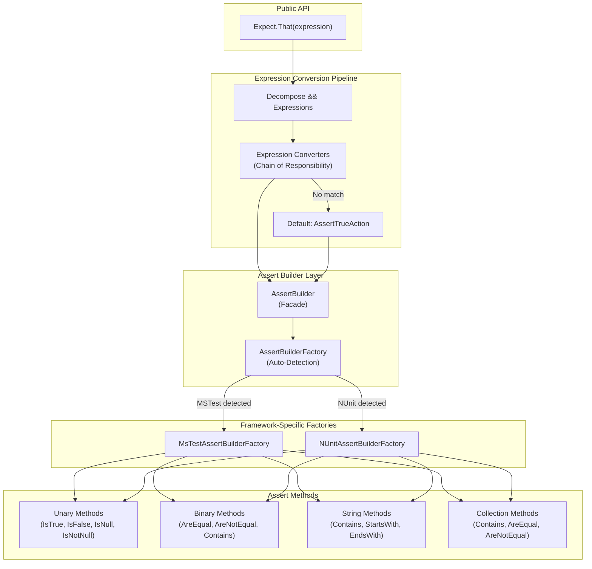
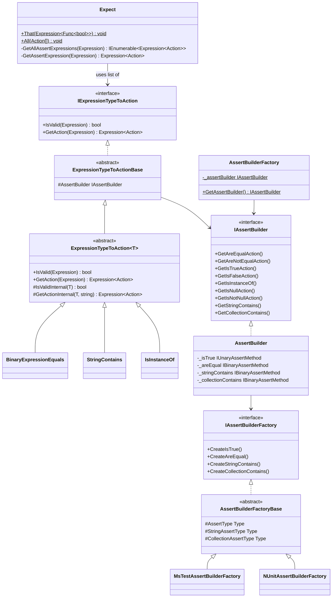
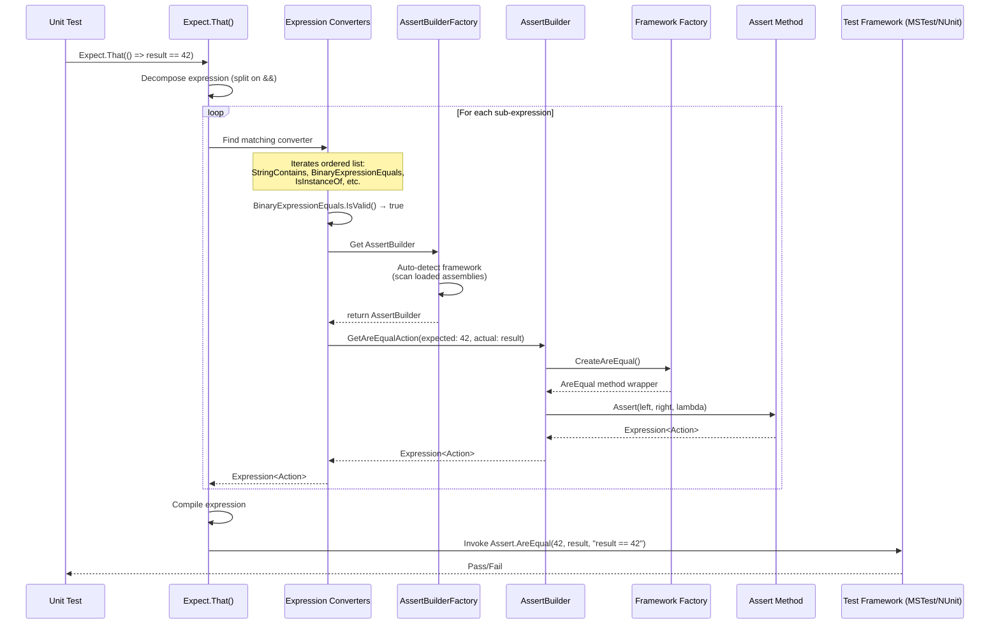
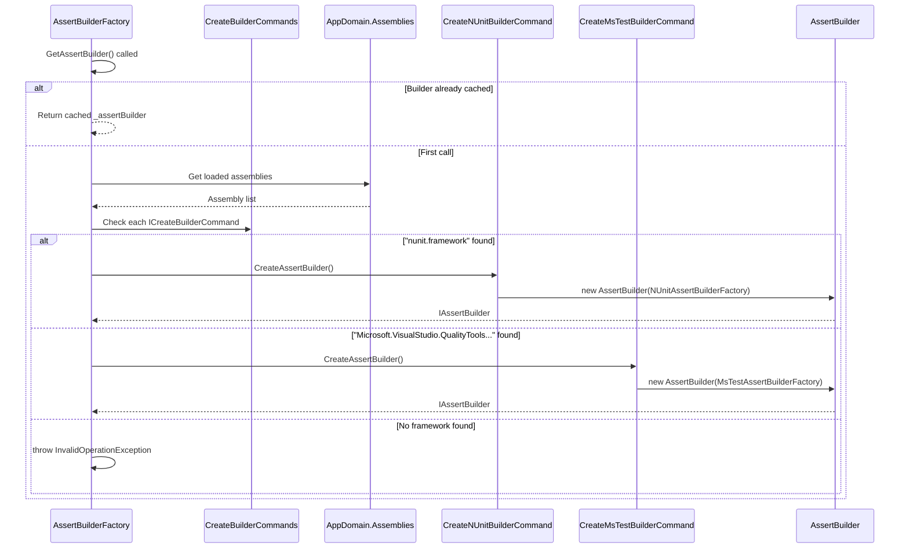

[](https://ci.appveyor.com/project/dhelper/asserthelper/branch/master)

# AssertHelper

**One assert to rule them all!**

A C# library that provides a unified, expression-based assertion API. Write natural boolean expressions and let AssertHelper automatically translate them into the appropriate framework-specific assertion calls for **NUnit** or **MSTest**.

## Usage

Use `Expect.That` and expressions to tell your unit testing what to check:

| Expression | Translates To |
|---|---|
| `Expect.That(() => value == true)` | `Assert.IsTrue` |
| `Expect.That(() => value == false)` | `Assert.IsFalse` |
| `Expect.That(() => value == null)` | `Assert.IsNull` |
| `Expect.That(() => value != null)` | `Assert.IsNotNull` |
| `Expect.That(() => result == expected)` | `Assert.AreEqual` |
| `Expect.That(() => result != expected)` | `Assert.AreNotEqual` |
| `Expect.That(() => result is expectedType)` | `Assert.IsInstanceOfType` |
| `Expect.That(() => aString.StartsWith(sub))` | `StringAssert.StartsWith` |
| `Expect.That(() => aString.EndsWith(sub))` | `StringAssert.EndsWith` |
| `Expect.That(() => aString.Contains(sub))` | `StringAssert.Contains` |
| `Expect.That(() => aCollection == expected)` | `CollectionAssert.AreEqual` |
| `Expect.That(() => aCollection != expected)` | `CollectionAssert.AreNotEqual` |
| `Expect.That(() => aCollection.Contains(val))` | `CollectionAssert.Contains` |

### Compound Assertions

Run several assertions using one call — they run independently and report all failures:

```csharp
Expect.That(() => a == 100 && b != null);
// → Assert.AreEqual(100, a) | Assert.IsNotNull(b)
```

---

## Architecture

### High-Level Component Diagram



### Class Diagram — Core Components



### Sequence Diagram — Assertion Execution Flow



### Sequence Diagram — Framework Auto-Detection



---

## Project Structure

```
AssertHelper/
├── AssertHelper.Core/                    # Main library
│   ├── Expect.cs                         # Public entry point
│   ├── ExpressionConverters/             # Expression → Assert mapping
│   │   ├── IExpressionTypeToAction.cs    # Converter interface
│   │   ├── ExpressionTypeToActionBase.cs # Base class
│   │   ├── ExpressionTypeToAction<T>.cs  # Generic typed base
│   │   ├── BinaryExpressionEquals.cs     # == operator handling
│   │   ├── BinaryExpressionNotEquals.cs  # != operator handling
│   │   ├── StringContains.cs            # String.Contains()
│   │   ├── IsInstanceOf.cs             # 'is' operator
│   │   └── ...
│   ├── AssertBuilders/                   # Framework abstraction
│   │   ├── IAssertBuilder.cs            # Builder interface
│   │   ├── AssertBuilder.cs             # Main builder impl
│   │   ├── AssertBuilderFactory.cs      # Auto-detection factory
│   │   ├── AssertBuilderFactoryBase.cs  # Shared factory logic
│   │   ├── MSTest/                      # MSTest support
│   │   ├── NUnit/                       # NUnit support
│   │   └── AssertMethods/               # Method wrappers
│   │       ├── Base/                    # Abstract bases
│   │       ├── AreEqual.cs
│   │       ├── IsTrue.cs
│   │       └── ...
│   └── Extensions/                      # Helper extensions
├── AssertHelper.Core.Tests.MSTest/      # MSTest integration tests
├── AssertHelper.Core.Tests.NUnit/       # NUnit integration tests
└── AssertHelper.sln
```

## Design Patterns

| Pattern | Where Used | Purpose |
|---------|-----------|---------|
| **Chain of Responsibility** | `ExpressionConverters` list in `Expect` | First matching converter handles the expression |
| **Abstract Factory** | `IAssertBuilderFactory` / `AssertBuilderFactoryBase` | Creates framework-specific assert method wrappers |
| **Command** | `ICreateBuilderCommand` | Encapsulates builder creation per framework |
| **Strategy** | `IExpressionTypeToAction` implementations | Different strategies for different expression types |
| **Facade** | `AssertBuilder` | Unified interface over all assertion types |
| **Singleton** | `AssertBuilderFactory._assertBuilder` | Cache the detected builder across calls |

## Supported Frameworks

- **MSTest** — Auto-detected via `Microsoft.VisualStudio.QualityTools.UnitTestFramework` assembly
- **NUnit** — Auto-detected via `nunit.framework` or `nunit.core` assembly
