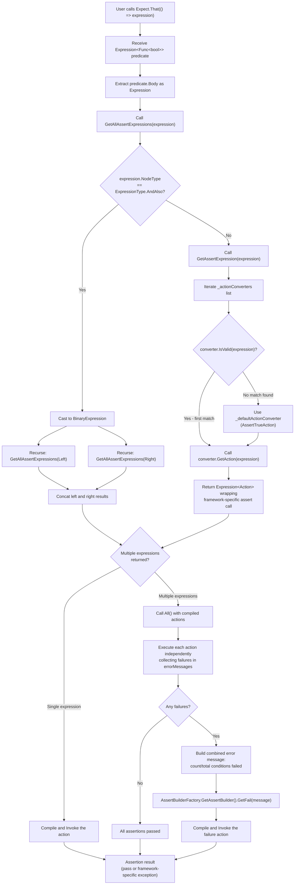
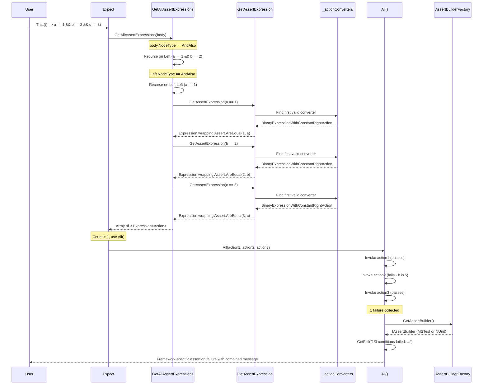

# AssertHelper Architecture

A unified assertion library for .NET that provides a single `Expect.That(() => expression)` API supporting both NUnit and MSTest frameworks. The library uses expression trees and the Strategy pattern to convert lambda expressions into framework-specific assert calls at runtime.

## Table of Contents

- [Component Architecture](#component-architecture)
- [Expression Evaluation Flow](#expression-evaluation-flow)
- [Compound Assertion Handling (AndAlso)](#compound-assertion-handling-andalso)
- [Extending with New Expression Types](#extending-with-new-expression-types)

---

## Component Architecture

The following diagram shows the overall structure of the AssertHelper library, including the Strategy pattern for expression converters and the Factory pattern for framework-specific assert builders.

```mermaid
graph TB
    subgraph "AssertHelper.Core"
        Expect["Expect (static class)<br/>That(Expression&lt;Func&lt;bool&gt;&gt;)"]

        subgraph "ExpressionConverters (Strategy Pattern)"
            IExpressionTypeToAction["IExpressionTypeToAction<br/>IsValid(Expression) : bool<br/>GetAction(Expression) : Expression&lt;Action&gt;"]
            Base["ExpressionTypeToActionBase"]

            subgraph "String Converters"
                StringContains["StringContains"]
                StringStartsWith["StringStartsWith"]
                StringEndsWith["StringEndsWith"]
            end

            subgraph "Binary Expression Converters"
                UnaryNot["UnaryNotExpressionToAction"]
                BinaryConstRight["BinaryExpressionWithConstantRightAction"]
                BinaryConstLeft["BinaryExpressionWithConstantLeftAction"]
                BinaryEquals["BinaryExpressionEquals"]
                BinaryNotEquals["BinaryExpressionNotEquals"]
            end

            subgraph "Collection Converters"
                EnumerableEquals["EnumerableEquals"]
                EnumerableContains["EnumerableContains"]
                CollectionContains["CollectionContains"]
            end

            subgraph "Type Converters"
                IsInstanceOf["IsInstanceOf"]
            end

            Fallback["AssertTrueAction (default fallback)"]
        end

        subgraph "AssertBuilders (Factory Pattern)"
            IAssertBuilder["IAssertBuilder<br/>GetAreEqualAction()<br/>GetIsTrueAction()<br/>GetIsFalseAction()<br/>GetIsNullAction()<br/>GetFail()<br/>..."]
            Factory["AssertBuilderFactory"]

            subgraph "MSTest"
                MsTestBuilder["MsTestAssertBuilderFactory"]
                CreateMsTest["CreateMsTestBuilderCommand"]
            end

            subgraph "NUnit"
                NUnitBuilder["NUnitAssertBuilderFactory"]
                CreateNUnit["CreateNUnitBuilderCommand"]
                CreateNUnitCore["CreateNUnitCoreBuilderCommand"]
            end
        end
    end

    subgraph "AssertHelper.TestBase"
        TestBase["FrameworkSpecificAssertTestsBase<br/>(shared test infrastructure)"]
    end

    subgraph "Test Projects"
        MSTestTests["AssertHelper.MSTest.Tests"]
        NUnitTests["AssertHelper.NUnit.Tests"]
        CoreTests["AssertHelper.Core.Tests"]
    end

    subgraph "AssertHelper.NuGet"
        NuGet["NuGet Package Project"]
    end

    Expect --> IExpressionTypeToAction
    IExpressionTypeToAction --> Base
    Base --> StringContains
    Base --> StringStartsWith
    Base --> StringEndsWith
    Base --> UnaryNot
    Base --> BinaryConstRight
    Base --> BinaryConstLeft
    Base --> BinaryEquals
    Base --> BinaryNotEquals
    Base --> EnumerableEquals
    Base --> EnumerableContains
    Base --> CollectionContains
    Base --> IsInstanceOf
    Base --> Fallback

    Base --> Factory
    Factory --> IAssertBuilder
    IAssertBuilder --> MsTestBuilder
    IAssertBuilder --> NUnitBuilder
    Factory --> CreateMsTest
    Factory --> CreateNUnit
    Factory --> CreateNUnitCore

    TestBase --> MSTestTests
    TestBase --> NUnitTests
    NuGet --> Expect
```



### Converter Priority Order

The converters are checked in the following order. The first converter whose `IsValid()` returns `true` wins:

| Priority | Converter | Matches | Maps To |
|----------|-----------|---------|---------|
| 1 | StringContains | `aString.Contains(sub)` | StringAssert.Contains |
| 2 | StringStartsWith | `aString.StartsWith(sub)` | StringAssert.StartsWith |
| 3 | StringEndsWith | `aString.EndsWith(sub)` | StringAssert.EndsWith |
| 4 | UnaryNotExpressionToAction | `!value` | Assert.IsFalse |
| 5 | BinaryExpressionWithConstantRightAction | `value == constant` | Assert.AreEqual / IsTrue / IsFalse / IsNull / IsNotNull |
| 6 | BinaryExpressionWithConstantLeftAction | `constant == value` | Assert.AreEqual (reversed) |
| 7 | EnumerableEquals | `collection == expected` | CollectionAssert.AreEqual |
| 8 | BinaryExpressionEquals | `result == expected` | Assert.AreEqual |
| 9 | BinaryExpressionNotEquals | `result != expected` | Assert.AreNotEqual |
| 10 | IsInstanceOf | `result is Type` | Assert.IsInstanceOfType |
| 11 | EnumerableContains | `IEnumerable.Contains(value)` | CollectionAssert.Contains |
| 12 | CollectionContains | `ICollection.Contains(value)` | CollectionAssert.Contains |
| Fallback | AssertTrueAction | (any unmatched expression) | Assert.IsTrue |

> **Note:** A `NotInstanceOf.cs` file exists in `ExpressionConverters/` but is **not registered** in the `_actionConverters` list in `Expect.cs`. This means it is dead/unused code and will never be reached during expression evaluation. It appears to be an unfinished or abandoned converter for handling `!(x is Type)` expressions.

---

## Expression Evaluation Flow

This is the core mechanism that makes the library work. When a user writes `Expect.That(() => someExpression)`, the library parses the expression tree and converts it into the appropriate framework-specific assertion call.



### Key Implementation Details

1. **Expression Tree Parsing**: The lambda `() => expression` is captured as an `Expression<Func<bool>>`, not evaluated immediately. This allows the library to inspect the structure of the assertion at runtime.

2. **Strategy Selection**: Each converter examines the expression tree node type and structure to determine if it can handle the assertion. For example, `StringContains` checks if the expression is a method call to `String.Contains()`.

3. **Framework Detection**: The `AssertBuilderFactory` scans loaded assemblies at runtime to detect whether NUnit or MSTest is present, then creates the appropriate builder to generate framework-specific assertion calls.

4. **Deferred Compilation**: The converters produce `Expression<Action>` objects (expression trees representing actions), which are compiled to delegates only at the final step before invocation.

---

## Compound Assertion Handling (AndAlso)

When a user writes compound assertions using `&&`, the library splits them into individual assertions and runs each independently, providing detailed failure information.



### Behavior Notes

- Each sub-assertion is executed independently, even if earlier ones fail
- The final error message reports how many of the total conditions failed
- The failure is reported using the detected framework's native failure mechanism
- This enables comprehensive assertion feedback in a single `Expect.That()` call

---

## Extending with New Expression Types

To add support for a new expression pattern, follow these steps:

### 1. Create a New Converter Class

Create a new class in `AssertHelper.Core/ExpressionConverters/` that extends `ExpressionTypeToActionBase`:

```csharp
internal class MyNewConverter : ExpressionTypeToActionBase
{
    public override bool IsValid(Expression expr)
    {
        // Return true if this converter can handle the expression
        // Check the expression's NodeType, method calls, etc.
    }

    public override Expression<Action> GetAction(Expression expression)
    {
        // Use AssertBuilder (inherited property) to construct
        // the appropriate framework-specific assertion
        return AssertBuilder.GetAreEqualAction(expected, actual, lambda);
    }
}
```

### 2. Register the Converter

Add the new converter to the `_actionConverters` list in `Expect.cs`. Position matters - converters are checked in order, and the first match wins:

```csharp
_actionConverters = new List<IExpressionTypeToAction>
{
    // ... existing converters ...
    new MyNewConverter(),  // Add before less-specific converters
    // ... remaining converters ...
};
```

### 3. Add IAssertBuilder Method (if needed)

If the new converter requires a framework-specific assertion that does not already exist on `IAssertBuilder`, add a new method to:

1. `IAssertBuilder` interface
2. `MsTestAssertBuilderFactory` (MSTest implementation)
3. `NUnitAssertBuilderFactory` (NUnit implementation)

### 4. Add Tests

Add test cases in both `AssertHelper.MSTest.Tests` and `AssertHelper.NUnit.Tests` to ensure the new expression type works across both frameworks. Use the shared `FrameworkSpecificAssertTestsBase` in `AssertHelper.TestBase` for common test logic.
